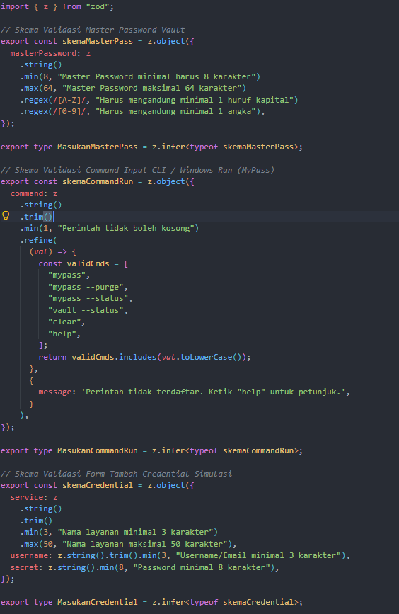
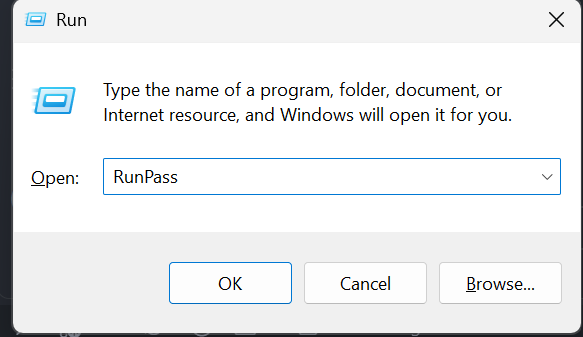
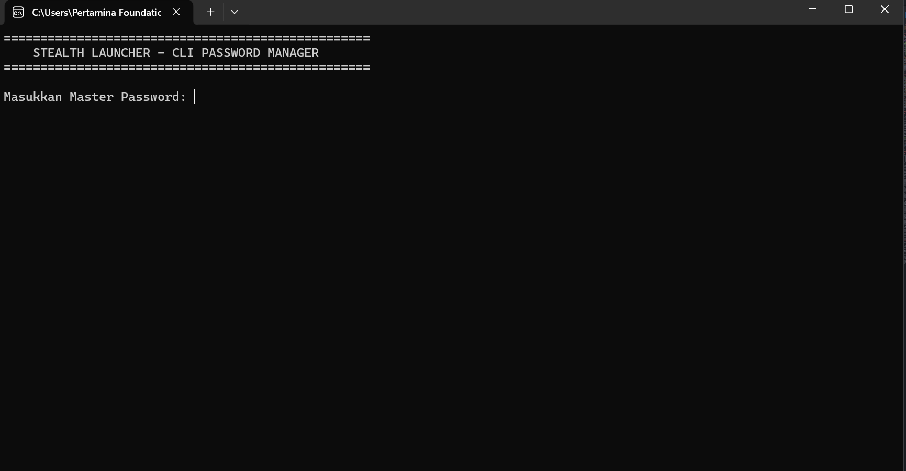
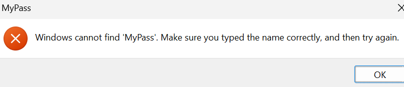
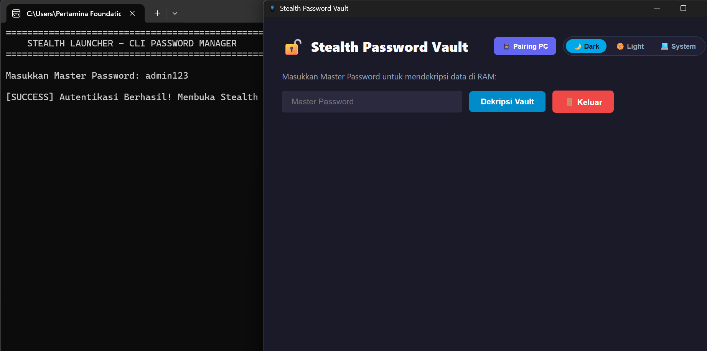
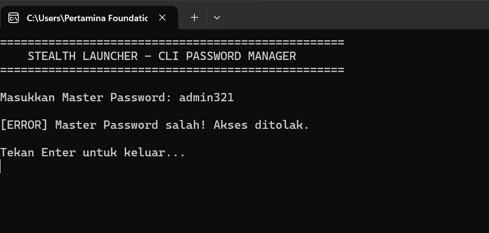

# Dokumen Teknis Modul 5: Formulir, Validasi, Session, dan Cookie

**Nama:** Gionaldo Chandrawansah  
**NIM:** 105224031  
**Repositori:** `https://github.com/GionaldoCandr/web-password-stealth-vault`  
**Produk:** Stealth Password Vault — Interactive Documentation & Lab Hub  

---

## 1. Skema Validasi

### Tabel Kolom Formulir & Aturan Zod 4
Pada aplikasi web ini, validasi bentuk masukan (*syntax validation*) diimplementasikan menggunakan **Zod 4** pada berkas `src/lib/skema.ts`.

| Nama Kolom | Tipe Data | Aturan Validasi Zod 4 | Pesan Galat (*Error Message*) |
| :--- | :--- | :--- | :--- |
| `masterPassword` | String | `min(8)`, `max(64)`, `regex(/[A-Z]/)`, `regex(/[0-9]/)` | "Master Password minimal 8 karakter", "Harus mengandung minimal 1 huruf kapital", "Harus mengandung minimal 1 angka" |
| `command` | String | `trim()`, `min(1)`, `refine(includes)` | "Perintah tidak boleh kosong", "Perintah tidak terdaftar. Ketik 'help' untuk petunjuk." |
| `service` | String | `trim()`, `min(3)`, `max(50)` | "Nama layanan minimal 3 karakter", "Nama layanan maksimal 50 karakter" |
| `username` | String | `trim()`, `min(3)` | "Username/Email minimal 3 karakter" |
| `secret` | String | `min(8)` | "Password minimal 8 karakter" |
| `email` | String | `email()` | "Format email tidak valid" |
| `kataSandi` | String | `min(8)` | "Kata sandi minimal 8 karakter" |

### Aturan Semantik di Server Action
**Aturan Semantik:**
1. **Verifikasi Hash/Kunci Master Password:** Memastikan *Master Password* yang dimasukkan cocok dengan KDF/Hash terenkripsi simulasi (`Stealth@2026`) untuk memicu dekripsi memori RAM.
2. **Keunikan Item Credential:** Memastikan nama layanan (*service*) belum pernah teralokasi di dalam *volatile store* RAM.

**Alasan Pemeriksaan di Server Action:**

Skema Zod 4 hanya memvalidasi bentuk atau format data (*syntactic structure*). Pengecekan seperti kecocokan password dengan hash atau ketersediaan data di memori memerlukan akses ke *database* atau *state store*, sehingga harus diproses di Server Action setelah `safeParse()` berhasil.

---

## 2. Alur Server Action

### Urutan Pemeriksaan di Dalam Server Action (`app/demo/actions.ts` / `app/masuk/actions.ts`)
Setiap Server Action memproses permintaan formulir dengan urutan keamanan sebagai berikut:
1. **Pemeriksaan Sesi (`bacaSesi()`):** Membaca cookie session ber-`HttpOnly`. Jika sesi tidak valid/kedaluwarsa, aksi dihentikan dan mengembalikan pesan `"Silakan masuk terlebih dahulu."`.
2. **Validasi Bentuk (`skema.safeParse()`):** Memeriksa struktur input FormData menggunakan Zod 4. Jika gagal, mengembalikan galat per kolom menggunakan `z.flattenError(hasil.error).fieldErrors`.
3. **Validasi Semantik:** Memeriksa kesesuaian data terhadap *state/store* (misal: verifikasi password atau keunikan kredensial).
4. **Mutasi Data:** Menjalankan alokasi memori RAM terenkripsi (`addCredential` / `unlockVault`). Jika terjadi exception tak terduga, dicatat di log server (`console.error`) dan mengembalikan pesan umum.
5. **Revalidasi & Redirect:** Memanggil `revalidatePath()` untuk memperbarui cache tampilan, dilanjutkan dengan `redirect()`. **`redirect()` wajib diletakkan di luar blok `try-catch`** karena mekanisme kerjanya melempar exception internal Next.js (`NEXT_REDIRECT`).

### Pembagian Berkas (Architecture Boundary)
* **Server Component (`app/masuk/page.tsx`, `app/lab/page.tsx`):** Merender struktur utama halaman dan memeriksa sesi sebelum merender komponen anak.
* **Client Component (`FormMasterPass.tsx`, `VaultSimulator.tsx`):** Menangani interaktivitas UI, form state via `useActionState`, dan kaitan atribut accessibility (`aria-invalid`, `aria-describedby`).
* **Berkas `"use server"` (`app/masuk/actions.ts`):** Tempat pengeksekusian Server Actions terisolasi yang menerima `FormData` dan mengelola cookie HTTP.
* **Berkas `"server-only"` (`lib/sesi.ts`):** Mengisolasi modul pengelolaan cookie dan sesi di tingkat server agar tidak sengaja terimpor ke Client Component.

---

## 3. Bukti Uji Validasi

### Tabel 8 Kasus Uji Penolakan Masukan

| No | Kasus Uji | Skenario Input | Hasil yang Diharapkan | Hasil Nyata | Status |
| :---: | :--- | :--- | :--- | :--- | :---: |
| 1 | Master Password Terlalu Pendek | `Pass1` | Ditolak: "Master Password minimal 8 karakter" | Pesan galat tampil di bawah field | LULUS |
| 2 | Master Password Tanpa Angka | `StealthPass` | Ditolak: "Harus mengandung minimal 1 angka" | Pesan galat tampil di bawah field | LULUS |
| 3 | Master Password Tanpa Kapital | `stealth2026` | Ditolak: "Harus mengandung minimal 1 huruf kapital" | Pesan galat tampil di bawah field | LULUS |
| 4 | Command Alias Tidak Dikenali | `mypass --unknown` | Ditolak: "Perintah tidak terdaftar..." | Pesan galat tampil pada terminal console | LULUS |
| 5 | Command Alias Kosong | `   ` (spasi saja) | Ditolak: "Perintah tidak boleh kosong" | Pesan galat tampil pada terminal console | LULUS |
| 6 | *Bypass Client 1* (`novalidate` MasterPass) | Form dikirim tanpa atribut required via HTML edit | Ditolak di Server Action via Zod 4 | Server mengembalikan galat `fieldErrors` | LULUS |
| 7 | *Bypass Client 2* (`novalidate` Command) | Input kosong dikirim langsung via POST | Ditolak di Server Action | Server mengembalikan pesan galat | LULUS |
| 8 | *Bypass Client 3* (`novalidate` Login) | Email invalid dikirim dengan `novalidate` | Ditolak: "Format email tidak valid" | Server mengembalikan galat per kolom | LULUS |

> **Tangkapan Layar Galat per Kolom:** 
// Sistem akan menerima jika passkey pada WIN + R benar  
>  

// Sistem gagal menerima Validation

//sistem akan menerima jika validation pass master benar dan langsung masuk ke sesion selama 180 aplikasi berjalan

//sistem gagal menerima passmaster langsung di rollback dan keluar dari CLI pass master



---

## 4. Session dan Cookie

### Atribut Cookie Sesi & Alasan Pemilihan
```
(await cookies()).set("sesi", id, {
  httpOnly: true,
  secure: process.env.NODE_ENV === "production",
  sameSite: "lax",
  path: "/",
  maxAge: 180, // 3 menit
});
```

###
---
HttpOnly: true: Mencegah skrip sisi klien (JavaScript/XSS) membaca nilai cookie melalui document.cookie.

Secure: true (Produksi): Memastikan cookie hanya ditransmisikan melalui protokol terenkripsi HTTPS.

SameSite: "lax": Mencegah serangan Cross-Site Request Forgery (CSRF) pada permintaan lintas situs.

Path: "/": Memastikan status sesi berlaku di seluruh rute aplikasi web-password-stealth-vault.

Max-Age: 180 : Membatasi umur masa berlaku cookie sesi maksimum selama 3 menit.

Tangkapan Layar & Hasil Uji Keamanan Session
Pemeriksaan DevTools (document.cookie):
Saat perintah document.cookie diketik di DevTools Console, cookie sesi tidak muncul/tersembunyi karena terproteksi atribut HttpOnly. Header HTTP Set-Cookie mencantumkan atribut HttpOnly; SameSite=Lax. (Nilai ID cookie disamarkan: sesi=8f9a****-****-****-****-****1e2d).

Uji Cookie Palsu:
Ketika nilai cookie sesi di Application DevTools diubah secara manual menjadi nilai acak/palsu, proxy.ts meloloskan navigasi awal, namun Server Action bacaSesi() gagal memvalidasi ID di in-memory store dan menampilkan pesan "Silakan masuk terlebih dahulu.". Data RAM Vault tidak bocor.

Uji Logout & Re-use Cookie Lama:
Setelah menekan tombol Keluar (Logout), ID sesi dihapus dari penyimpanan server (penyimpanan.delete(id)). Saat cookie lama ditempelkan kembali secara manual di peramban, permintaan ditolak dan dialihkan ke /masuk karena ID sesi sudah tidak terdaftar (invalidated).

---

## 5. Keputusan Teknis
Pola Session di Server vs Token Tanpa Status (JWT)
Pada aplikasi ini dipilih Pola Session di Server (Stateful Session with In-Memory Map).

Alasan: Pada sistem keamanan tinggi seperti Stealth Password Vault, kemampuan untuk mencabut hak akses secara instan (instant revocation/session termination) sangat krusial. Pada JWT tanpa status, token yang dicuri tetap dapat digunakan hingga masa kedaluwarsanya habis kecuali dibuat sistem blacklisting yang rumit. Dengan session di server, menghapus ID dari memori server saat logout akan langsung membatalkan akses secara real-time.

Batas Peran proxy.ts vs Pemeriksaan di Server Action
Peran proxy.ts (Next.js 16 Middleware/Proxy): Berfungsi sebagai pemeriksaan optimistik cepat (quick optimistic check) di tingkat Edge/Routing untuk mengecek keberadaan cookie sesi. Jika cookie tidak ada, pengguna langsung dialihkan (redirect) ke /masuk sebelum komponen dirender.

Peran Pemeriksaan di Server Action: Berfungsi sebagai validasi otoritatif utama (source of truth). Server Action membaca isi cookie dan memverifikasi keabsahan ID sesi ke storage/database. Hal ini wajib dilakukan karena konfig matcher pada proxy.ts dapat terlewat, dan atribut cookie di peramban dapat dipalsukan oleh penyerang.

---
## 6. Kendala dan Penyelesaian
Galat ReferenceError: Terminal is not defined / Missing Export Chrome:

Penyebab: Penggunaan ikon Chrome dari lucide-react tidak tersedia pada versi terbaru, dan komponen Terminal belum terimpor di SideBarNav.tsx.

Penyelesaian: Mengganti impor ikon Chrome menjadi Globe dan melengkapi impor Terminal dari lucide-react.

Galat usePathname() Outside <Suspense> pada Dynamic Route Next.js 16:

Penyebab: Next.js 16 dengan Turbopack mendeteksi pembacaan URL runtime (usePathname() & params) pada rute dinamis /docs/[slug] tanpa pembungkus <Suspense>.

Penyelesaian: Membungkus SideBarNavContent dengan komponen <Suspense fallback={...}> dan menyediakan fungsi generateStaticParams() pada rute dinamis [slug].

---
## 7. Catatan Pemanfaatan AI
Alat AI: Gemini AI (Google)

Perintah Utama (Prompting):
"Buatkan skema validasi Zod 4 dan Server Action untuk Master Password Vault serta penanganan galat per kolom dengan useActionState"

"Bantu atasi galat Next.js 16 usePathname outside Suspense di Turbopack"

Bagian yang Digunakan: Pembuatan draf struktur folder modular, penyusunan skema Zod 4 (src/lib/skema.ts), skrip simulasi enkripsi WebCrypto (src/lib/crypto-mock.ts), dan penyusunan tabel kasus uji dokumen teknis.

Cara Memverifikasi: Setiap potongan kode yang dihasilkan diuji langsung menggunakan perintah npx tsc --noEmit, npm run lint, serta pengujian fitur secara langsung melalui server pengembangan local npm run dev pada rute /docs dan /lab.