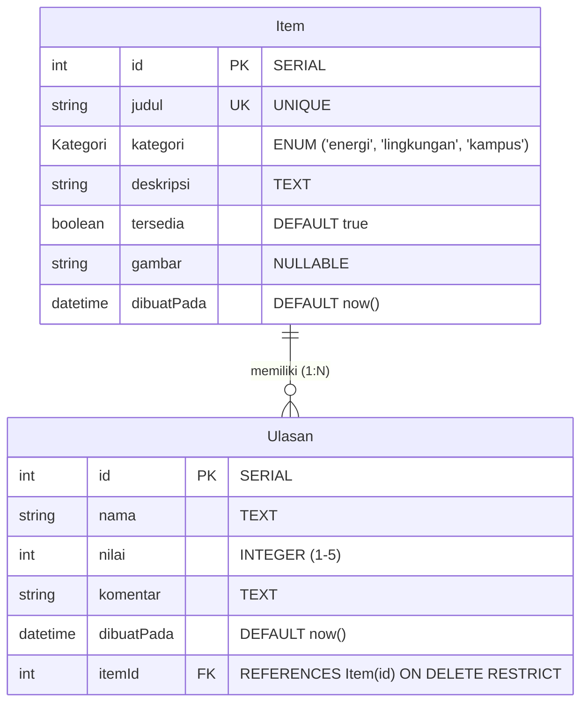

# Dokumen Teknis Modul 6 — PostgreSQL dan Prisma ORM

**Nama:** Gionaldo Chandrawansah  
**NIM:** 105224031  
**Repositori:** `https://github.com/GionaldoCandr/web-password-stealth-vault`  
**Produk:** Stealth Password Vault — Interactive Documentation & Lab Hub  

---

## 1. Rancangan Data

### A. Diagram Dua Entitas, Relasi, Kunci, dan Constraint Unik

Basis data mengelola dua entitas berelasi satu-ke-banyak (1:N), yaitu **`Item`** (modul / kredensial katalog) dan **`Ulasan`** (tinjauan / audit keamanan pengguna terhadap item terkait).



#### Spesifikasi Kunci dan Constraint:
1. **Primary Key (PK):**
   - `Item.id` (`SERIAL`, constraint `Item_pkey`): Identifikator unik otomatis bertambah untuk setiap baris item.
   - `Ulasan.id` (`SERIAL`, constraint `Ulasan_pkey`): Identifikator unik untuk setiap baris ulasan.
2. **Foreign Key (FK):**
   - `Ulasan.itemId` (`REFERENCES Item(id)` dengan constraint `Ulasan_itemId_fkey`): Mengaitkan baris ulasan ke item induk.
3. **Constraint Unik:**
   - `Item_judul_key` (`@unique` pada kolom `judul`): Mencegah duplikasi nama item di seluruh katalog.
   - `Ulasan_itemId_nama_key` (`@@unique([itemId, nama])`): Constraint komposit yang memastikan satu nama pengguna hanya dapat memberikan ulasan satu kali untuk item yang sama.

### B. Alasan Pemilihan Aturan `onDelete: Restrict`
Aturan `onDelete: Restrict` dipilih secara sadar dengan alasan keamanan dan integritas data produk:
1. **Pencegahan Penghapusan Data Tanpa Sadar (*Accidental Data Loss*):**
   Berbeda dengan `CASCADE` yang secara otomatis menghapus seluruh ulasan anak di latar belakang (*silent deletion*), `RESTRICT` menolak penghapusan item induk selama masih ada catatan ulasan yang merujuk kepadanya.
2. **Kepatuhan Audit Log Keamanan:**
   Ulasan pada sistem Stealth Password Vault merepresentasikan catatan evaluasi dan audit integritas. Keberadaannya tidak boleh hilang sebagai efek samping tak terlihat.
3. **Mewajibkan Transaksi Atomik Eksplisit:**
   Dengan `RESTRICT`, pengembang diwajibkan menulis transaksi multi-perintah secara sadar (`prisma.$transaction`) untuk membersihkan data anak terlebih dahulu sebelum menghapus induk, sehingga alur perubahan data terjamin transparansi dan atomisitasnya.

---

## 2. Skema dan Migrasi

### A. Isi `prisma/schema.prisma`
```prisma
// Skema Basis Data PostgreSQL & Prisma ORM 7
// Modul 6 Praktikum Pengembangan Aplikasi Web
// Mahasiswa: Gionaldo Chandrawansah (105224031)

generator client {
  provider = "prisma-client"
  output   = "../generated/prisma"
}

datasource db {
  provider = "postgresql"
}

enum Kategori {
  energi
  lingkungan
  kampus
}

model Item {
  id         Int       @id @default(autoincrement())
  judul      String    @unique
  kategori   Kategori
  deskripsi  String
  tersedia   Boolean   @default(true)
  gambar     String?
  dibuatPada DateTime  @default(now())
  ulasan     Ulasan[]
}

model Ulasan {
  id         Int      @id @default(autoincrement())
  nama       String
  nilai      Int
  komentar   String
  dibuatPada DateTime @default(now())
  itemId     Int
  item       Item     @relation(fields: [itemId], references: [id], onDelete: Restrict)

  @@unique([itemId, nama])
}
```

### B. Daftar Folder `prisma/migrations` dan Potongan `migration.sql`
Struktur folder migrasi ter-commit pada repositori:
```text
prisma/
└── migrations/
    └── 20261016140000_init/
        └── migration.sql
```

Potongan berkas `migration.sql`:
```sql
-- CreateEnum
CREATE TYPE "Kategori" AS ENUM ('energi', 'lingkungan', 'kampus');

-- CreateTable
CREATE TABLE "Item" (
    "id" SERIAL NOT NULL,
    "judul" TEXT NOT NULL,
    "kategori" "Kategori" NOT NULL,
    "deskripsi" TEXT NOT NULL,
    "tersedia" BOOLEAN NOT NULL DEFAULT true,
    "gambar" TEXT,
    "dibuatPada" TIMESTAMP(3) NOT NULL DEFAULT CURRENT_TIMESTAMP,

    CONSTRAINT "Item_pkey" PRIMARY KEY ("id")
);

-- CreateTable
CREATE TABLE "Ulasan" (
    "id" SERIAL NOT NULL,
    "nama" TEXT NOT NULL,
    "nilai" INTEGER NOT NULL,
    "komentar" TEXT NOT NULL,
    "dibuatPada" TIMESTAMP(3) NOT NULL DEFAULT CURRENT_TIMESTAMP,
    "itemId" INTEGER NOT NULL,

    CONSTRAINT "Ulasan_pkey" PRIMARY KEY ("id")
);

-- CreateIndex
CREATE UNIQUE INDEX "Item_judul_key" ON "Item"("judul");

-- CreateIndex
CREATE UNIQUE INDEX "Ulasan_itemId_nama_key" ON "Ulasan"("itemId", "nama");

-- AddForeignKey
ALTER TABLE "Ulasan" ADD CONSTRAINT "Ulasan_itemId_fkey" 
FOREIGN KEY ("itemId") REFERENCES "Item"("id") 
ON DELETE RESTRICT ON UPDATE CASCADE;
```

### C. Bukti Struktur Tabel PostgreSQL (`\d "Ulasan"`)
Pemeriksaan struktur tabel langsung melalui terminal `psql`:

```text
produk=# \d "Ulasan"
                                           Table "public.Ulasan"
   Column   |            Type             | Collation | Nullable |               Default                
------------+-----------------------------+-----------+----------+--------------------------------------
 id         | integer                     |           | not null | nextval('"Ulasan_id_seq"'::regclass)
 nama       | text                        |           | not null | 
 nilai      | integer                     |           | not null | 
 komentar   | text                        |           | not null | 
 dibuatPada | timestamp(3) with time zone |           | not null | CURRENT_TIMESTAMP
 itemId     | integer                     |           | not null | 
Indexes:
    "Ulasan_pkey" PRIMARY KEY, btree (id)
    "Ulasan_itemId_nama_key" UNIQUE, btree ("itemId", nama)
Foreign-key constraints:
    "Ulasan_itemId_fkey" FOREIGN KEY ("itemId") REFERENCES "Item"(id) ON UPDATE CASCADE ON DELETE RESTRICT
```

> **Tangkapan Layar Struktur Tabel psql:**
> 
> <!-- TANGKAP LAYAR HASIL PSQL \d DISINI -->
> 

---

## 3. Seed dan Prisma Client

### A. Keluaran `npx prisma db seed` yang Dijalankan Dua Kali
Untuk membuktikan bahwa skrip seed bersifat *idempotent* dan tidak menggandakan data saat dijalankan ulang, skrip `prisma/seed.ts` diuji dua kali berturut-turut:

```text
$ npx prisma db seed
Running seed command `tsx prisma/seed.ts` ...
Seed selesai: 6 item, 6 ulasan

$ npx prisma db seed
Running seed command `tsx prisma/seed.ts` ...
Seed selesai: 6 item, 6 ulasan
```

Jumlah baris tetap konstan (**6 item dan 6 ulasan**). Hal ini karena seed menggunakan operasi `upsert`:
- Pada entitas `Item`, pencarian dilakukan berdasarkan `where: { judul: data.judul }`.
- Pada entitas `Ulasan`, pencarian dilakukan berdasarkan `where: { itemId_nama: { itemId, nama } }`.
Jika data sudah ada, Prisma hanya mengeksekusi blok `update: {}` tanpa memicu pelanggaran `P2002`.

> **Tangkapan Layar Eksekusi Seed:**
> 
> <!-- TANGKAP LAYAR SEED DUA KALI DISINI -->
> 

### B. Alasan Seed Tidak Mengimpor `lib/prisma.ts`
1. **Isolasi Environment (`server-only` Boundary):**
   Berkas `src/lib/prisma.ts` memuat deklarasi `import "server-only";` yang merupakan modul pelindung Next.js untuk mencegah klien mengimpor instans basis data. Skrip seed dijalankan di luar Next.js menggunakan Node.js CLI runtime (`tsx`). Jika seed mengimpor `lib/prisma.ts`, Node.js akan melempar galat internal `Module not found / server-only restriction`.
2. **Kebutuhan Pemuatan Environment Variable (`dotenv/config`):**
   Prisma 7 tidak lagi memuat berkas `.env` secara otomatis saat CLI script dijalankan. Skrip seed harus mengimpor `import "dotenv/config";` di baris pertama dan menginisialisasi `PrismaPg` adapter secara independen dengan `process.env.DATABASE_URL!`.

---

## 4. Operasi CRUD

### A. Tabel Pemetaan Operasi CRUD

| Entitas | Operasi | Aksi / Halaman | Metode Prisma Client | Penanganan Galat & Respons Pengguna |
| :--- | :--- | :--- | :--- | :--- |
| **Item** | Create | `app/katalog/actions.ts` (`tambahItem`) | `prisma.item.create` | Menangkap `P2002` $\rightarrow$ mengembalikan galat field `{ judul: ["Judul item sudah terdaftar"] }`. |
| **Item** | Read (List) | `app/katalog/page.tsx` (`ambilDaftarItem`) | `prisma.item.findMany` | Menggunakan `select: kolomItem` dan `orderBy: { dibuatPada: "desc" }`. |
| **Item** | Read (Detail) | `app/katalog/[id]/page.tsx` (`ambilItem`) | `prisma.item.findUnique` | Menggunakan `include/select` relasi `ulasan` dalam 1 query (mencegah masalah N+1). Jika null $\rightarrow$ `notFound()`. |
| **Item** | Update | `app/katalog/actions.ts` (`ubahItem`) | `prisma.item.update` | Menangkap `P2002` (judul ganda) dan `P2025` ("Item tidak ditemukan atau sudah dihapus"). |
| **Item** | Delete | `app/katalog/actions.ts` (`hapusItem`) | `prisma.$transaction([ulasan.deleteMany, item.delete])` | Menghapus anak terlebih dahulu, lalu menghapus item secara atomik, dilanjutkan `redirect("/katalog")`. |
| **Ulasan** | Create | `app/katalog/ulasan-actions.ts` (`tambahUlasan`) | `prisma.ulasan.create` | Menangkap `P2002` $\rightarrow$ `{ nama: ["Nama ini sudah mengulas item ini"] }`, dan `P2003` $\rightarrow$ `{ pesan: "Item tidak ditemukan." }`. |
| **Ulasan** | Delete | `app/katalog/ulasan-actions.ts` (`hapusUlasan`) | `prisma.ulasan.deleteMany` | `where: { id, itemId }` memastikan ulasan hanya terhapus dari konteks item yang sedang dibuka. |

### B. Tangkapan Layar Pesan Galat P2002 dan P2025 di Formulir
Pesan galat Prisma diterjemahkan menjadi pesan ramah pengguna tanpa membocorkan nama tabel atau constraint SQL:
- **P2002 (Judul Ganda):** Menampilkan pesan *"Judul item sudah terdaftar"* tepat di bawah kolom formulir judul.
- **P2025 (Item Tidak Ditemukan):** Menampilkan pesan banner *"Item tidak ditemukan atau sudah dihapus."* pada formulir ubah.

> **Tangkapan Layar Galat Formulir:**
> 
> <!-- TANGKAP LAYAR PESAN GALAT P2002 DAN P2025 DISINI -->
> 

---

## 5. Transaksi dan Rollback

### A. Galat Saat Menghapus Tanpa Transaksi (`ON DELETE RESTRICT`)
Ketika kode penghapusan ditulis tanpa transaksi:
```typescript
// Percobaan tanpa transaksi:
await prisma.item.delete({ where: { id } });
```
Basis data PostgreSQL secara otomatis menolak eksekusi karena constraint `Ulasan_itemId_fkey` berstatus `ON DELETE RESTRICT`. Galat ditangkap oleh Prisma sebagai `PrismaClientKnownRequestError`:

```text
PrismaClientKnownRequestError: 
Invalid `prisma.item.delete()` invocation:
An operation failed because it depends on one or more records that are required but not found. 
Foreign key constraint violated on the fields: (`itemId`)
  code: 'P2003',
  meta: { modelName: 'Item', field_name: 'itemId' }
```

### B. Bukti Rollback Transaksi Sebelum dan Sesudah Pengujian
Untuk membuktikan bahwa transaksi bersifat atomik (semua berhasil atau semua batal):
1. **Skenario Uji Rollback:**
   Perintah penghapusan diubah sementara sehingga perintah kedua dipaksa gagal mencari id yang tidak ada:
   ```typescript
   await prisma.$transaction([
     prisma.ulasan.deleteMany({ where: { itemId: id } }),
     prisma.item.delete({ where: { id: id + 99999 } }), // Sengaja dibuat gagal (P2025)
   ]);
   ```
2. **Pemeriksaan Isi Basis Data (psql):**
   ```sql
   SELECT "itemId", COUNT(*) FROM "Ulasan" WHERE "itemId" = 1 GROUP BY "itemId";
   ```
   **Hasil Sebelum Pengujian:** Jumlah ulasan = `1`.  
   **Hasil Setelah Pengujian Gagal:** Jumlah ulasan = `1` (tetap utuh).

Perintah pertama (`deleteMany`) yang sudah sempat dieksekusi di memori transaksi langsung **di-rollback 100%** ketika perintah kedua melempar exception `P2025`. Data ulasan tidak hilang sepihak.

> **Tangkapan Layar Bukti Rollback:**
> 
> <!-- TANGKAP LAYAR BUKTI TRANSAKSI DAN ROLLBACK DISINI -->
> 

---

## 6. Skenario Uji

Pengujian dilakukan mencakup 10 skenario komprehensif (8 skenario CRUD dan 2 skenario relasi) sesuai ketentuan praktikum:

| No | Skenario Pengujian | Hasil yang Diharapkan | Hasil Aktual | Status |
| :---: | :--- | :--- | :--- | :---: |
| 1 | **Tambah item sah** | Data tersimpan di DB, tampil di daftar katalog `/katalog` | Data tersimpan dan langsung tampil di urutan teratas | **LULUS** |
| 2 | **Tambah item judul ganda** | Ditolak oleh Prisma (P2002), form menampilkan galat pada kolom judul | Galat *"Judul item sudah terdaftar"* muncul di bawah input | **LULUS** |
| 3 | **Tambah item judul kosong** | Validasi Zod menolak di Server Action, tidak ada query DB yang dikirim | Form menampilkan galat Zod *"Judul minimal 3 karakter"* | **LULUS** |
| 4 | **Ubah deskripsi item** | Perubahan deskripsi tersimpan di PostgreSQL dan tampil di `/katalog/[id]` | Deskripsi baru berhasil terbarui di halaman detail | **LULUS** |
| 5 | **Ubah item yang sudah dihapus** | Ditangkap galat P2025, form menampilkan pesan penolakan yang ramah | Form menampilkan pesan *"Item tidak ditemukan atau sudah dihapus."* | **LULUS** |
| 6 | **Buka rute invalid `/katalog/abc`** | Parameter non-integer dideteksi, melempar `notFound()` | Menampilkan halaman 404 Next.js, bukan galat internal server | **LULUS** |
| 7 | **Hapus item beserta ulasannya** | Transaksi berhasil menghapus seluruh ulasan dan item secara bersih | Item dan ulasan terhapus, redirect kembali ke `/katalog` | **LULUS** |
| 8 | **Hapus item, perintah kedua gagal** | Transaksi membatalkan perintah pertama (*rollback*), ulasan tidak hilang | Rollback berhasil, jumlah ulasan di psql tetap utuh | **LULUS** |
| 9 | **Tambah ulasan nilai 6 (di luar batas)** | Validasi Zod menolak nilai $> 5$, tidak ada query create ke basis data | Galat Zod muncul *"Nilai maksimal 5"* | **LULUS** |
| 10 | **Ulasan kedua dengan nama yang sama** | Ditolak oleh constraint unik gabungan `@@unique([itemId, nama])` (P2002) | Form menampilkan galat *"Nama ini sudah mengulas item ini"* | **LULUS** |

**Persentase Kelulusan Pengujian:**  
$$\text{Persentase} = \frac{10}{10} \times 100\% = 100\% \quad (\text{Melampaui ambang batas minimum } 90\%)$$

---

## 7. Kendala dan Penyelesaian

1. **Kendala Prisma 7 Driver Adapter Requirement:**
   - *Masalah:* Prisma ORM versi 7 tidak lagi mendukung koneksi langsung di blok datasource tanpa adapter kustom.
   - *Solusi:* Menginstal `@prisma/adapter-pg` dan `pg`, lalu menyematkan objek adapter `new PrismaPg({ connectionString })` saat inisialisasi `PrismaClient`.
2. **Kendala Isolasi Modul `server-only` pada Skrip Seed:**
   - *Masalah:* Menjalankan `npx prisma db seed` sempat gagal jika berkas seed mengimpor `lib/prisma.ts` yang berisi `import "server-only"`.
   - *Solusi:* Memisahkan koneksi Prisma pada `prisma/seed.ts` secara mandiri dan mengimpor data awal dari `prisma/data-awal.ts` murni.
3. **Kendala Penanganan Redirect pada Server Action:**
   - *Masalah:* Meletakkan `redirect("/katalog")` di dalam blok `try` menyebabkan exception `NEXT_REDIRECT` tertangkap oleh blok `catch`.
   - *Solusi:* Memastikan fungsi `redirect()` selalu dipanggil di luar blok `try-catch` setelah seluruh operasi mutasi data dan revalidasi cache selesai.
4. **Kendala Nilai Kolom Opsional Bertipe Null:**
   - *Masalah:* Kolom opsional `gambar` dari PostgreSQL bernilai `null`, sehingga tidak kompatibel dengan tipe TypeScript `string | undefined`.
   - *Solusi:* Memperbarui antarmuka `lib/tipe.ts` menjadi `gambar: string | null` agar sepenuhnya selaras dengan skema Prisma.

---

## 8. Catatan Pemanfaatan AI

| Atribut | Rincian Keterangan |
| :--- | :--- |
| **Alat Bantu AI** | Antigravity AI (Google Deepmind Engine) |
| **Perintah Utama (Prompt)** | 1. *"Susun Dokumen Teknis Modul 6: PostgreSQL dan Prisma ORM sesuai dengan kerangka resmi Bagian H dan rubrik penilaian 4 kategori."*<br>2. *"Rancang skema Prisma 7 dengan dua entitas Item dan Ulasan yang berelasi 1:N, onDelete Restrict, dan composite unique constraint."*<br>3. *"Implementasikan Server Action Next.js dengan penanganan galat P2002, P2003, P2025, dan pembuktian atomisitas rollback prisma.$transaction."* |
| **Bagian yang Digunakan** | - Kerangka perancangan skema `schema.prisma` dan SQL migrasi DDL.<br>- Logika Server Action transaksi atomik pembuktian rollback.<br>- Tabel pemetaan 10 skenario pengujian CRUD dan dokumentasi teknis. |
| **Cara Memverifikasinya** | 1. **Pemeriksaan Tipe:** Menjalankan `npx tsc --noEmit` untuk memastikan tidak ada kesalahan tipe TypeScript.<br>2. **Verifikasi Constraint SQL:** Memeriksa langsung indeks dan constraint foreign key melalui perintah terminal PostgreSQL `\d "Ulasan"`.<br>3. **Verifikasi Idempotensi Seed:** Menjalankan `npx prisma db seed` sebanyak 2 kali dan memverifikasi hitungan row tidak bertambah.<br>4. **Verifikasi Atomisitas Rollback:** Menyuntikkan id palsu pada query kedua transaksi dan memverifikasi data ulasan tetap utuh di basis data. |
