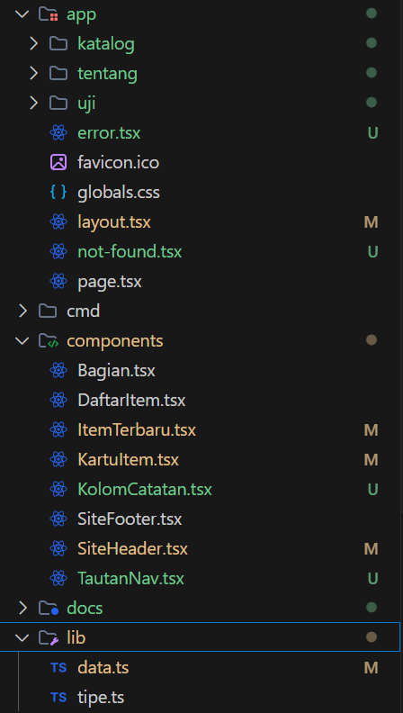
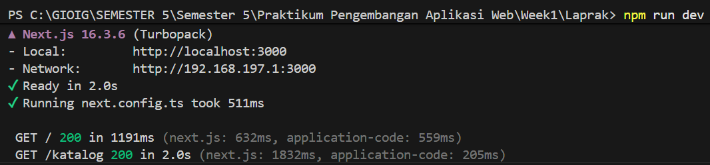
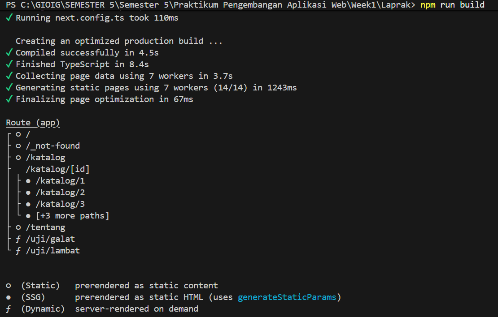
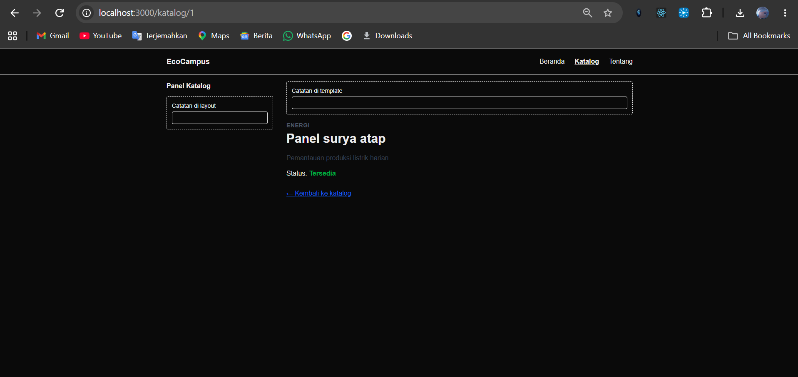
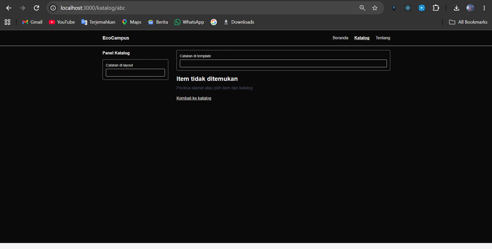
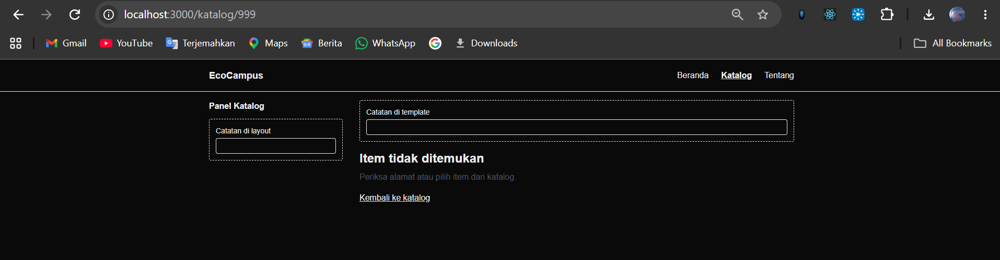
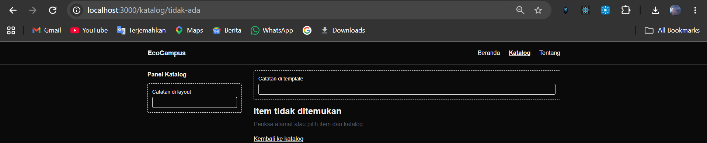
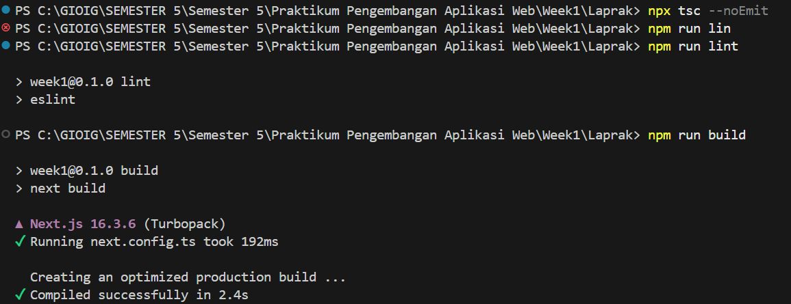

# Dokumen Teknis Modul 4: Next.js App Router

Nama/NIM : Gionaldo Candrawansah / 1052224031  
Repositori Lama : https://github.com/GionaldoCandr/Pratikum_Pengembangan_Aplikasi_Web  
Repositori Baru : https://github.com/GionaldoCandr/web-password-stealth-vault
Versi Next.js dan mode Cache Components (aktif/tidak) : Next.js 16.3.6 / Tidak aktif (cacheComponents: false/default)

---

## 1. Peta Rute

### Tabel Peta Rute Aplikasi
| URL | Berkas di `app/` | Jenis Rute | Isi Halaman |
| --- | --- | --- | --- |
| `/` | `app/page.tsx` | Statis | Halaman beranda: Kalimat nilai produk, ikhtisar cara kerja, kartu item terbaru, dan formulir kontak. |
| `/katalog` | `app/katalog/page.tsx` | Statis | Katalog produk dengan fitur pencarian real-time dan penyaringan berbasis kategori. |
| `/katalog/[id]` | `app/katalog/[id]/page.tsx` | Dinamis (SSG via `generateStaticParams`) | Detail item berdasarkan parameter ID dengan penanganan `notFound()`. |
| `/tentang` | `app/tentang/page.tsx` | Statis | Informasi profil produk, latar belakang, dan solusi yang ditawarkan EcoCampus. |
| `/uji/lambat` | `app/uji/lambat/page.tsx` | Dinamis (Server-rendered via `connection()`) | Pengujian streaming server render dan fallback `<Suspense>` (`loading.tsx`). |
| `/uji/galat` | `app/uji/galat/page.tsx` | Dinamis (Server-rendered via `connection()`) | Pengujian penanganan galat runtime dan error boundary (`error.tsx`). |

### Potongan Tabel Rute dari Keluaran `npm run build`
```text
Route (app)
┌ ○ /
├ ○ /_not-found
├ ○ /katalog
├   /katalog/[id]
│ ├ ● /katalog/1
│ ├ ● /katalog/2
│ ├ ● /katalog/3
│ └ ● [+3 more paths]
├ ○ /tentang
├ ƒ /uji/galat
└ ƒ /uji/lambat

○  (Static)   prerendered as static content
●  (SSG)      prerendered as static HTML (uses generateStaticParams)
ƒ  (Dynamic)  server-rendered on demand
```

---

## 2. Layout, Template, dan Berkas Khusus

### Pohon Folder `app/` Akhir




```text
Penjelasan Meliputi
app/
├── error.tsx                 # Root Error Boundary (Client Component)
├── favicon.ico
├── globals.css               # Styling global & Tailwind CSS v4
├── layout.tsx                # Root layout (memuat <html>, <body>, header, footer)
├── not-found.tsx             # 404 global untuk URL tidak dikenal
├── page.tsx                  # Beranda EcoCampus
├── katalog/
│   ├── layout.tsx            # Nested layout segmen katalog (persistent state)
│   ├── template.tsx          # Template segmen katalog (remount state saat navigasi rute anak)
│   ├── loading.tsx           # Fallback loading segmen katalog
│   ├── error.tsx             # Error boundary segmen katalog
│   ├── page.tsx              # Halaman daftar katalog
│   └── [id]/
│       ├── not-found.tsx     # 404 khusus segmen [id] (item tidak ditemukan)
│       └── page.tsx          # Halaman dinamis detail item
├── tentang/
│   └── page.tsx              # Halaman tentang produk
└── uji/
    ├── error.tsx             # Error boundary pengujian
    ├── loading.tsx           # Suspense fallback pengujian
    ├── galat/
    │   └── page.tsx          # Simulasi error server
    └── lambat/
        └── page.tsx          # Simulasi penundaan response
```

### Hasil Uji Layout vs Template
- **Perilaku `layout.tsx`**: State pada komponen `KolomCatatan` di dalam layout dipertahankan saat terjadi navigasi antar-subrute segmen katalog (misalnya dari `/katalog` ke `/katalog/1`). Hal ini karena layout tidak di-remount oleh Next.js.
- **Perilaku `template.tsx`**: State pada `KolomCatatan` di dalam template akan otomatis dikosongkan/direset saat berganti segmen anak. Next.js membuat instansi baru dan memasang ulang (remount) seluruh pohon DOM template dengan memberikan unique key per rute anak.

### Pengamatan `loading.tsx` dan `error.tsx`
- **`loading.tsx`**: Ketika mengakses rute lambat seperti `/uji/lambat`, server Next.js secara instan mengirimkan UI fallback dengan peran `role="status"` ("Memuat data uji…") sementara konten utama sedang disiapkan secara asynchronous di server tanpa memblokir header dan footer.
- **`error.tsx` (Dev vs Production)**:
  - Pada mode *Development* (`npm run dev`), error boundary menampilkan pesan asli error yang dilempar server (`error.message`: *"Koneksi ke sumber data gagal (galat uji)"*).
  
  - Pada mode *Production* (`npm run build` & `npm start`), Next.js menyamarkan detail pesan galat server menjadi pesan generik demi alasan keamanan dan menyertakan kode `digest` unik untuk pencocokan dengan log internal server.
  
  

---

## 3. Rute Dinamis dan Validasi params

### Tabel Uji Rute Dinamis
| URL | Hasil yang Diharapkan | Hasil Aktual | Kode Status HTTP (`curl`) |
| --- | --- | --- | --- |
| `http://localhost:3000/katalog/1` | Menampilkan detail produk Panel surya atap | Detail produk tampil sesuai data | `200 OK` |
| `http://localhost:3000/katalog/abc` | Menampilkan "Item tidak ditemukan" (`not-found.tsx` segmen) | Tampilan 404 segmen katalog tampil | `404 Not Found` |
| `http://localhost:3000/katalog/999` | Menampilkan "Item tidak ditemukan" (`not-found.tsx` segmen) | Tampilan 404 segmen katalog tampil | `404 Not Found` |
| `http://localhost:3000/tidak-ada` | Menampilkan "Halaman tidak ditemukan" (`app/not-found.tsx`) | Tampilan 404 global tampil | `404 Not Found` |






### Penjelasan Aturan Validasi params
Pada Next.js 16, `params` diterima sebagai `Promise<{ id: string }>` dan wajib di-`await` di Server Component:
```typescript
const { id } = await params;
```
1. **Validasi Format String**: Menggunakan regex `/^[1-9]\d*$/`. Pola ini memastikan nilai `id` hanya berupa bilangan bulat positif tanpa awalan angka nol (menolak `"abc"`, `"0"`, `"-5"`, `"03"`). Jika tidak lolos, fungsi `notFound()` langsung dipanggil.
2. **Pencarian Data**: String `id` dikonversi ke tipe number dengan `Number(id)`, kemudian dicari menggunakan fungsi `cariItem(Number(id))` pada modul `lib/data.ts`.
3. **Pemeriksaan Eksistensi**: Jika `cariItem` mengembalikan `undefined` (misalnya ID `999`), maka fungsi `notFound()` dipanggil untuk merender `app/katalog/[id]/not-found.tsx`.

---

## 4. Pembagian Server dan Client Components

### Tabel Pembagian Komponen
| Komponen / Berkas | Jenis Komponen | Alasan Teknis |
| --- | --- | --- |
| `app/layout.tsx` | Server Component | Berada di root level, tidak membutuhkan React state/browser event, efisien untuk SEO dan SSR. |
| `app/page.tsx` | Server Component | Menampilkan konten beranda statis dan merender komponen anak tanpa overhead JavaScript klien. |
| `app/katalog/page.tsx` | Server Component | Mengambil data item secara statis di server dan menyalurkannya ke komponen interaktif melalui props. |
| `app/katalog/[id]/page.tsx` | Server Component | Melakukan pre-rendering halaman statis via `generateStaticParams` dan membaca `params` asynchronous. |
| `app/tentang/page.tsx` | Server Component | Konten informasi statis yang tidak memerlukan interaktivitas klien. |
| `components/Bagian.tsx` | Server Component | Wrapper semantik visual sederhana dengan prop `children`, tidak menggunakan hooks. |
| `components/KartuItem.tsx` | Server Component | Merender tautan detail dan ringkasan data produk tanpa state internal. |
| `components/ItemTerbaru.tsx` | Server Component | Mengakses `daftarItem` langsung dari `lib/data.ts` di sisi server, mereduksi payload bundle browser. |
| `components/SiteHeader.tsx` | Server Component | Berfungsi sebagai wrapper navigasi yang membungkus `TautanNav` dengan `<Suspense>`. |
| `components/SiteFooter.tsx` | Server Component | Tampilan footer informasi hak cipta statis. |
| `components/TautanNav.tsx` | Client Component (`"use client"`) | Menggunakan hook `usePathname()` untuk mendeteksi rute aktif dan mengatur atribut `aria-current="page"`. |
| `components/DaftarItem.tsx` | Client Component (`"use client"`) | Membutuhkan `useState` untuk controlled input pencarian dan seleksi tombol filter kategori. |
| `components/KolomCatatan.tsx` | Client Component (`"use client"`) | Membutuhkan `useState` dan `useId` untuk menguji perbedaan persistensi state antara layout dan template. |
| `app/error.tsx` & `app/uji/error.tsx` | Client Component (`"use client"`) | Next.js mewajibkan error boundary berjenis Client Component untuk menangkap error dan menyediakan event tombol `reset()`. |

### Hasil Uji Impor `lib/data.ts` (`server-only`) dari Client Component
Ketika baris `import "server-only";` diterapkan pada `lib/data.ts`, modul tersebut secara ketat dibatasi hanya boleh dieksekusi di lingkungan server. Apabila modul ini dicoba diimpor secara langsung oleh Client Component (misalnya `components/DaftarItem.tsx`), bundler Next.js akan mendeteksi pelanggaran batas server-klien dan menghentikan proses kompilasi dengan pesan galat:
> *"You're importing a component that needs 'server-only'. That only works in a Server Component which is not supported in the client module graph."*

Hal ini menjamin bahwa modul server-side terlindungi dari kebocoran ke bundle JavaScript klien.

---

## 5. Verifikasi

Hasil verifikasi lingkungan dan kode program:
- `npx tsc --noEmit` : **Berhasil (Exit Code 0, tidak ada error tipe)**
- `npm run lint`     : **Berhasil (Exit Code 0, bersih tanpa peringatan)**
- `npm run build`    : **Berhasil (Kompilasi Turbopack sukses, seluruh 14 rute ter-generate dengan benar)**
- 

---

## 6. Kendala dan Penyelesaian
1. **Sintaksis Terputus pada KartuItem**: Terdapat tag pembuka `<h3>` yang salah ketik menjadi `h3` tanpa kurung siku `<` serta impor `Link` yang terlewat. Diperbaiki dengan melengkapi deklarasi tag dan mengimpor `Link` dari `next/link`.
2. **Duplikasi Komponen**: File `components/ItemTerbaru.tsx`, `components/SiteHeader.tsx`, dan `app/not-found.tsx` sebelumnya menggabungkan dua versi implementasi berbeda dalam satu file. Masalah ini diselesaikan dengan memisahkan dan merapikan komponen sesuai spesifikasi Modul 4.
3. **Double Render pada Root Layout**: File `app/layout.tsx` merender `{children}` dua kali dan menggunakan tipe `LayoutProps` yang tidak terdefinisi. Masalah ini diperbaiki dengan mendefinisikan prop `{ children }: { children: React.ReactNode }` dan menata struktur layout secara semantik.
4. **Pemasangan Paket `server-only`**: Modul `lib/data.ts` membutuhkan paket `server-only` agar tidak terjadi error kompilasi paket hilang saat menandai modul data server. Paket berhasil dipasang menggunakan `npm install server-only`.

---

## 7. Catatan Pemanfaatan AI
- **Alat**: Antigravity Assistant (Google DeepMind)
- **Perintah Utama**: Analisis struktur folder, diagnosis error kompilasi TypeScript dan Next.js Turbopack, perbaikan sintaksis komponen, dan verifikasi build produksi.
- **Bagian yang Digunakan**: Pemeriksaan kompabilitas Next.js 16 App Router, refaktorisasi komponen Server vs Client, serta penyusunan dokumen teknis.
- **Cara Memverifikasi**: Menjalankan pengujian berulang menggunakan `npx tsc --noEmit`, `npm run lint`, dan `npm run build` langsung pada terminal PowerShell hingga semua verifikasi lulus dengan kode keluar 0.
