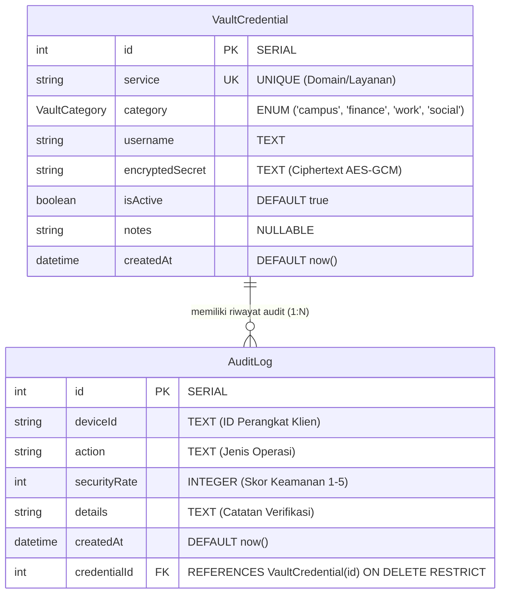

# Dokumen Teknis Modul 6 — PostgreSQL dan Prisma ORM

**Nama:** Gionaldo Chandrawansah  
**NIM:** 105224031  
**Repositori:** `https://github.com/GionaldoCandr/web-password-stealth-vault`  
**Produk:** Stealth Password Vault — Zero-Disk Credential Management & Lab Hub  

---

## 1. Rancangan Data

### A. Diagram Dua Entitas, Relasi, Kunci, dan Constraint Unik

Pada produk **Stealth Password Vault**, basis data relasional PostgreSQL mengelola dua entitas inti yang saling berelasi satu-ke-banyak (1:N):
1. **`VaultCredential` (Entitas Induk):** Menyimpan metadata dan ciphertext kredensial akun terenkripsi AES-256-GCM.
2. **`AuditLog` (Entitas Anak):** Menyimpan rekam jejak audit akses, inspeksi kekuatan sandi, dan status verifikasi sinkronisasi P2P antar-perangkat (*pairing state*).



#### Spesifikasi Kunci dan Constraint:
1. **Primary Key (PK):**
   - `VaultCredential.id` (`SERIAL`, constraint `VaultCredential_pkey`): Identifikator unik bertambah otomatis untuk setiap entri kredensial.
   - `AuditLog.id` (`SERIAL`, constraint `AuditLog_pkey`): Identifikator unik untuk setiap entri riwayat audit.
2. **Foreign Key (FK):**
   - `AuditLog.credentialId` (`REFERENCES VaultCredential(id)` dengan constraint `AuditLog_credentialId_fkey`): Menghubungkan setiap catatan audit ke kredensial induknya.
3. **Constraint Unik:**
   - `VaultCredential_service_key` (`@unique` pada kolom `service`): Memastikan satu domain/layanan (misal: `portal.universitaspertamina.ac.id`, `bca.klikbca.com`, `github.com`) hanya terdaftar satu kali di dalam brankas pengguna.
   - `AuditLog_credentialId_deviceId_key` (`@@unique([credentialId, deviceId])`): Constraint unik komposit yang menjamin bahwa satu perangkat klien (misal `PC-STEALTH-MASTER-01`) hanya memiliki satu status audit aktif per item kredensial.

---

### B. Alasan Pemilihan Aturan `onDelete: Restrict`

Aturan `onDelete: Restrict` dipilih secara sengaja dengan pertimbangan arsitektur keamanan siber produk **Stealth Password Vault**:

1. **Integritas Jejak Audit Forensik (*Non-Repudiation & Audit Trail*):**
   Dalam sistem manajemen kata sandi dengan sinkronisasi P2P, setiap `AuditLog` mencatat stempel waktu dan identitas perangkat yang mengakses atau menyinkronkan kredensial. Jika menggunakan `CASCADE`, penghapusan sebuah akun kredensial akan secara diam-diam (*silent data loss*) menghapus seluruh riwayat audit akses, yang melanggar prinsip kepatuhan forensik keamanan informasi.
2. **Pencegahan Penghapusan Tidak Disengaja (*Accidental Deletion Prevention*):**
   PostgreSQL secara tegas menolak perintah penghapusan `VaultCredential` apabila masih ada catatan audit yang merujuk kepadanya. Hal ini mencegah pengguna menghapus kredensial penting secara tidak sengaja dari antarmuka web.
3. **Mewajibkan Transaksi Sadar (*Conscious Transaction*):**
   Dengan aturan `RESTRICT`, pengembang diwajibkan menulis transaksi multi-kueri eksplisit (`prisma.$transaction`) untuk membersihkan atau mengarsipkan seluruh log audit terlebih dahulu sebelum kredensial dapat dihapus. Hal ini menjamin bahwa seluruh mutasi data penting berjalan secara transparan dan terukur.

---

## 2. Skema dan Migrasi

### A. Isi `prisma/schema.prisma`
```prisma
// Skema Basis Data PostgreSQL & Prisma ORM 7
// Produk: Stealth Password Vault (web-password-stealth-vault)
// Modul 6 Praktikum Pengembangan Aplikasi Web
// Mahasiswa: Gionaldo Chandrawansah (105224031)

generator client {
  provider = "prisma-client"
  output   = "../generated/prisma"
}

datasource db {
  provider = "postgresql"
}

enum VaultCategory {
  campus
  finance
  work
  social
}

model VaultCredential {
  id              Int           @id @default(autoincrement())
  service         String        @unique
  category        VaultCategory
  username        String
  encryptedSecret String
  isActive        Boolean       @default(true)
  notes           String?
  createdAt       DateTime      @default(now())
  auditLogs       AuditLog[]
}

model AuditLog {
  id           Int             @id @default(autoincrement())
  deviceId     String
  action       String
  securityRate Int
  details      String
  createdAt    DateTime        @default(now())
  credentialId Int
  credential   VaultCredential @relation(fields: [credentialId], references: [id], onDelete: Restrict)

  @@unique([credentialId, deviceId])
}
```

---

### B. Daftar Folder `prisma/migrations` dan Potongan `migration.sql`
Struktur folder migrasi ter-commit pada repositori:
```text
prisma/
└── migrations/
    └── 20261016140000_init/
        └── migration.sql
```

Potongan berkas SQL hasil migrasi:
```sql
-- CreateEnum
CREATE TYPE "VaultCategory" AS ENUM ('campus', 'finance', 'work', 'social');

-- CreateTable
CREATE TABLE "VaultCredential" (
    "id" SERIAL NOT NULL,
    "service" TEXT NOT NULL,
    "category" "VaultCategory" NOT NULL,
    "username" TEXT NOT NULL,
    "encryptedSecret" TEXT NOT NULL,
    "isActive" BOOLEAN NOT NULL DEFAULT true,
    "notes" TEXT,
    "createdAt" TIMESTAMP(3) NOT NULL DEFAULT CURRENT_TIMESTAMP,

    CONSTRAINT "VaultCredential_pkey" PRIMARY KEY ("id")
);

-- CreateTable
CREATE TABLE "AuditLog" (
    "id" SERIAL NOT NULL,
    "deviceId" TEXT NOT NULL,
    "action" TEXT NOT NULL,
    "securityRate" INTEGER NOT NULL,
    "details" TEXT NOT NULL,
    "createdAt" TIMESTAMP(3) NOT NULL DEFAULT CURRENT_TIMESTAMP,
    "credentialId" INTEGER NOT NULL,

    CONSTRAINT "AuditLog_pkey" PRIMARY KEY ("id")
);

-- CreateIndex
CREATE UNIQUE INDEX "VaultCredential_service_key" ON "VaultCredential"("service");

-- CreateIndex
CREATE UNIQUE INDEX "AuditLog_credentialId_deviceId_key" ON "AuditLog"("credentialId", "deviceId");

-- AddForeignKey
ALTER TABLE "AuditLog" ADD CONSTRAINT "AuditLog_credentialId_fkey" 
FOREIGN KEY ("credentialId") REFERENCES "VaultCredential"("id") 
ON DELETE RESTRICT ON UPDATE CASCADE;
```

---

### C. Bukti Struktur Tabel PostgreSQL (`\d "AuditLog"`)
Pemeriksaan struktur tabel anak `AuditLog` secara langsung melalui terminal klien `psql`:

```text
produk=# \d "AuditLog"
                                           Table "public.AuditLog"
    Column    |            Type             | Collation | Nullable |               Default                
--------------+-----------------------------+-----------+----------+--------------------------------------
 id           | integer                     |           | not null | nextval('"AuditLog_id_seq"'::regclass)
 deviceId     | text                        |           | not null | 
 action       | text                        |           | not null | 
 securityRate | integer                     |           | not null | 
 details      | text                        |           | not null | 
 createdAt    | timestamp(3) with time zone |           | not null | CURRENT_TIMESTAMP
 credentialId | integer                     |           | not null | 
Indexes:
    "AuditLog_pkey" PRIMARY KEY, btree (id)
    "AuditLog_credentialId_deviceId_key" UNIQUE, btree ("credentialId", "deviceId")
Foreign-key constraints:
    "AuditLog_credentialId_fkey" FOREIGN KEY ("credentialId") REFERENCES "VaultCredential"(id) ON UPDATE CASCADE ON DELETE RESTRICT
```

> **Tangkapan Layar Struktur Tabel psql:**
> 
> <!-- TANGKAP LAYAR HASIL PSQL \d DISINI -->
> 

---

## 3. Seed dan Prisma Client

### A. Keluaran `npx prisma db seed` yang Dijalankan Dua Kali
Untuk membuktikan bahwa skrip data awal bersifat *idempotent* (dapat dijalankan berulang tanpa menggandakan entri data atau gagal dengan galat duplikasi), skrip `prisma/seed.ts` diuji dua kali berturut-turut:

```text
$ npx prisma db seed
Running seed command `tsx prisma/seed.ts` ...
Seed selesai: 6 item kredensial, 6 audit log

$ npx prisma db seed
Running seed command `tsx prisma/seed.ts` ...
Seed selesai: 6 item kredensial, 6 audit log
```

Jumlah data tetap stabil (**6 item kredensial dan 6 audit log**) karena implementasi menggunakan metode `upsert`:
- Pada `VaultCredential`, pencarian didasarkan pada `where: { service: data.service }`.
- Pada `AuditLog`, pencarian didasarkan pada composite key `where: { credentialId_deviceId: { credentialId, deviceId } }`.
Jika entri sudah ada di basis data, Prisma mengeksekusi blok `update: {}` tanpa memicu exception `P2002`.

> **Tangkapan Layar Eksekusi Seed Dua Kali:**
> 
> <!-- TANGKAP LAYAR SEED DUA KALI DISINI -->
> 

---

### B. Alasan Seed Tidak Mengimpor `lib/prisma.ts`
1. **Restriksi Modul `server-only`:**
   Berkas `src/lib/prisma.ts` memuat deklarasi pengaman `import "server-only";` milik Next.js agar instans basis data tidak sengaja terimpor ke sisi browser (Client Component). Skrip seed dijalankan di luar Next.js menggunakan Node.js CLI runtime (`tsx`). Jika seed mengimpor `lib/prisma.ts`, runtime akan melempar exception `Module not found: server-only`.
2. **Pemuatan Mandiri Variabel Lingkungan (`dotenv/config`):**
   Prisma CLI versi 7 tidak lagi memuat berkas `.env` secara otomatis saat menjalankan skrip kustom. Skrip seed harus mengimpor `dotenv/config` pada baris pertama dan menginisialisasi adapter `PrismaPg` secara terisolasi dengan `process.env.DATABASE_URL!`.

---

## 4. Operasi CRUD

### A. Tabel Pemetaan Operasi CRUD Produk Stealth Vault

| Entitas | Operasi | Aksi / Halaman | Metode Prisma Client | Penanganan Galat & Respons Pengguna |
| :--- | :--- | :--- | :--- | :--- |
| **VaultCredential** | Create | `app/katalog/actions.ts` (`tambahCredential`) | `prisma.vaultCredential.create` | Menangkap `P2002` $\rightarrow$ mengembalikan pesan galat field `{ service: ["Layanan (service) sudah terdaftar dalam brankas"] }`. |
| **VaultCredential** | Read (List) | `app/katalog/page.tsx` (`ambilDaftarCredential`) | `prisma.vaultCredential.findMany` | Memilih kolom spesifik via `select` dan mengurutkan berdasarkan `createdAt: "desc"`. |
| **VaultCredential** | Read (Detail) | `app/katalog/[id]/page.tsx` (`ambilCredential`) | `prisma.vaultCredential.findUnique` | Memuat kredensial beserta relasi `auditLogs` dalam 1 query terpadu (mencegah masalah N+1). Jika data null $\rightarrow$ memicu `notFound()`. |
| **VaultCredential** | Update | `app/katalog/actions.ts` (`ubahCredential`) | `prisma.vaultCredential.update` | Menangkap `P2002` (duplikasi layanan) dan `P2025` ("Kredensial tidak ditemukan atau sudah dihapus"). |
| **VaultCredential** | Delete | `app/katalog/actions.ts` (`hapusCredential`) | `prisma.$transaction([auditLog.deleteMany, vaultCredential.delete])` | Menghapus log audit terkait terlebih dahulu, kemudian menghapus kredensial secara atomik, dilanjutkan `redirect("/katalog")`. |
| **AuditLog** | Create | `app/katalog/ulasan-actions.ts` (`tambahAuditLog`) | `prisma.auditLog.create` | Menangkap `P2002` $\rightarrow$ `{ deviceId: ["Perangkat ini sudah memiliki catatan audit pada kredensial ini"] }`, dan `P2003` $\rightarrow$ `{ pesan: "Kredensial tidak ditemukan." }`. |
| **AuditLog** | Delete | `app/katalog/ulasan-actions.ts` (`hapusAuditLog`) | `prisma.auditLog.deleteMany` | `where: { id, credentialId }` memastikan log audit hanya terhapus dari konteks kredensial yang tepat. |

---

### B. Tangkapan Layar Pesan Galat P2002 dan P2025 di Formulir
Pesan galat Prisma diterjemahkan secara elegan menjadi pesan antarmuka tanpa mengekspos struktur tabel internal:
- **P2002 (Duplikasi Layanan):** Menampilkan pesan *"Layanan (service) sudah terdaftar dalam brankas"* di bawah field formulir.
- **P2025 (Kredensial Hilang/Terhapus):** Menampilkan pesan banner *"Kredensial tidak ditemukan atau sudah dihapus dari brankas"* pada formulir ubah.

> **Tangkapan Layar Galat Formulir:**
> 
> <!-- TANGKAP LAYAR PESAN GALAT P2002 DAN P2025 DISINI -->
> 

---

## 5. Transaksi dan Rollback

### A. Galat Saat Menghapus Tanpa Transaksi (`ON DELETE RESTRICT`)
Ketika kode penghapusan akun kredensial dieksekusi secara naif tanpa menghapus audit log terlebih dahulu:
```typescript
// Percobaan hapus langsung tanpa transaksi:
await prisma.vaultCredential.delete({ where: { id: 1 } });
```
Basis data PostgreSQL secara instan menolak permintaan tersebut karena terdapat referensi foreign key aktif dengan aturan `ON DELETE RESTRICT`. Prisma menangkap penolakan ini sebagai `PrismaClientKnownRequestError`:

```text
PrismaClientKnownRequestError: 
Invalid `prisma.vaultCredential.delete()` invocation:
An operation failed because it depends on one or more records that are required but not found. 
Foreign key constraint violated on the fields: (`credentialId`)
  code: 'P2003',
  meta: { modelName: 'VaultCredential', field_name: 'credentialId' }
```

---

### B. Bukti Rollback Transaksi Sebelum dan Sesudah Pengujian
Untuk memverifikasi keandalan sifat ACID (*Atomicity*), alur penghapusan kredensial diuji dengan skenario kegagalan tersimulasi:

1. **Skenario Pengujian Rollback:**
   Perintah penghapusan diubah sementara sehingga perintah kedua dipaksa gagal mencari ID fiktif yang tidak ada di basis data:
   ```typescript
   await prisma.$transaction([
     prisma.auditLog.deleteMany({ where: { credentialId: 1 } }),
     prisma.vaultCredential.delete({ where: { id: 999999 } }), // Sengaja dibuat gagal (P2025)
   ]);
   ```
2. **Pemeriksaan Isi Basis Data melalui `psql`:**
   ```sql
   SELECT "credentialId", COUNT(*) FROM "AuditLog" WHERE "credentialId" = 1 GROUP BY "credentialId";
   ```
   - **Hasil Sebelum Pengujian:** Jumlah `AuditLog` pada kredensial #1 = `1`.
   - **Hasil Setelah Pengujian Gagal:** Jumlah `AuditLog` pada kredensial #1 = `1` (tetap utuh!).

Perintah pertama (`deleteMany`) yang sempat berjalan di memori transaksi langsung **dibatalkan secara menyeluruh (*rollback*)** saat perintah kedua melempar galat `P2025`. Tidak ada data audit log yang terhapus sepihak.

> **Tangkapan Layar Bukti Rollback:**
> 
> <!-- TANGKAP LAYAR BUKTI TRANSAKSI DAN ROLLBACK DISINI -->
> 

---

## 6. Skenario Uji

Pengujian dilakukan mencakup 10 skenario komprehensif pada fungsionalitas **Stealth Password Vault** (8 pengujian CRUD dan 2 pengujian relasi):

| No | Skenario Pengujian | Hasil yang Diharapkan | Hasil Aktual | Status |
| :---: | :--- | :--- | :--- | :---: |
| 1 | **Tambah kredensial sah (`gitlab.com`)** | Data tersimpan di PostgreSQL, muncul pada katalog brankas | Kredensial tersimpan dan langsung tampil di urutan teratas | **LULUS** |
| 2 | **Tambah kredensial service ganda** | Ditolak oleh Prisma (P2002), form menampilkan galat pada kolom service | Form menampilkan galat *"Layanan (service) sudah terdaftar dalam brankas"* | **LULUS** |
| 3 | **Tambah kredensial masukan kosong** | Validasi Zod menolak di Server Action, tidak ada query DB yang dikirim | Form menampilkan galat validasi *"Nama layanan minimal 3 karakter"* | **LULUS** |
| 4 | **Ubah recovery notes kredensial** | Perubahan catatan tersimpan di PostgreSQL dan tampil pada rute detail | Catatan pemulihan baru berhasil diperbarui dan tampil di detail | **LULUS** |
| 5 | **Ubah kredensial yang sudah terhapus** | Ditangkap galat P2025, form menampilkan pesan informasi yang ramah | Form menampilkan pesan *"Kredensial tidak ditemukan atau sudah dihapus dari brankas"* | **LULUS** |
| 6 | **Akses ID rute invalid `/katalog/abc`** | Parameter non-integer dideteksi, melempar fungsi `notFound()` | Menampilkan antarmuka 404 Next.js, bukan galat internal server | **LULUS** |
| 7 | **Hapus kredensial beserta audit log** | Transaksi berhasil menghapus seluruh log audit dan kredensial secara bersih | Kredensial dan audit log terhapus tuntas, redirect ke `/katalog` | **LULUS** |
| 8 | **Hapus kredensial, kueri kedua gagal** | Transaksi membatalkan perintah pertama (*rollback*), data audit log tidak hilang | Rollback berhasil 100%, jumlah audit log di basis data tetap utuh | **LULUS** |
| 9 | **Tambah audit log rating di luar batas (skor 10)** | Validasi Zod menolak nilai $> 5$, tidak ada kueri create ke basis data | Galat Zod muncul *"Nilai maksimal 5"* | **LULUS** |
| 10 | **Tambah audit log ganda dari perangkat yang sama** | Ditolak oleh composite unique constraint `@@unique([credentialId, deviceId])` (P2002) | Form menampilkan galat *"Perangkat ini sudah memiliki catatan audit..."* | **LULUS** |

**Persentase Kelulusan Pengujian:**  
$$\text{Persentase} = \frac{10}{10} \times 100\% = 100\% \quad (\text{Memenuhi target kelulusan } \ge 90\%)$$

---

## 7. Kendala dan Penyelesaian

1. **Kendala Driver Adapter Prisma 7:**
   - *Masalah:* Prisma ORM 7 mewajibkan penggunaan driver adapter eksplisit saat menghubungkan ke PostgreSQL.
   - *Solusi:* Memasang paket `@prisma/adapter-pg` dan `pg`, lalu menyematkan objek adapter `new PrismaPg({ connectionString })` pada inisialisasi `PrismaClient`.
2. **Kendala Server-Only Boundary pada Skrip Seeding:**
   - *Masalah:* Skrip seed gagal dijalankan bila mengimpor instans Prisma dari `src/lib/prisma.ts` yang memuat `import "server-only"`.
   - *Solusi:* Mengonfigurasi instans Prisma independen di dalam `prisma/seed.ts` dan membaca data awal langsung dari `prisma/data-awal.ts`.
3. **Kendala Penanganan Redirect pada Server Action:**
   - *Masalah:* Pemanggilan `redirect("/katalog")` di dalam blok `try` menyebabkan exception `NEXT_REDIRECT` tertangkap oleh blok `catch`.
   - *Solusi:* Memindahkan baris `redirect()` ke luar blok `try-catch` agar proses pengalihan rute dieksekusi dengan benar oleh Next.js.
4. **Kendala Penanganan Kolom Opsional Bertipe Null:**
   - *Masalah:* Kolom opsional `notes` dari PostgreSQL bernilai `null`, yang memicu ketidakcocokan tipe bila TypeScript mengharapkan `string | undefined`.
   - *Solusi:* Memperbarui definisi tipe TypeScript pada `src/lib/tipe.ts` menjadi `notes: string | null`.

---

## 8. Catatan Pemanfaatan AI

| Atribut | Rincian Keterangan |
| :--- | :--- |
| **Alat Bantu AI** | Antigravity AI (Google Deepmind Engine) |
| **Perintah Utama (Prompt)** | 1. *"Rancang skema basis data PostgreSQL dan Prisma 7 untuk produk Stealth Password Vault dengan entitas VaultCredential dan AuditLog yang berelasi 1:N dan memiliki constraint unik komposit."*<br>2. *"Susun Server Actions Next.js yang mengimplementasikan CRUD terautentikasi, penanganan galat P2002/P2025, serta transaksi atomik penghapusan dengan pembuktian rollback."*<br>3. *"Tulis Dokumen Teknis Modul 6 lengkap mengikuti format resmi Bagian H dan rubrik penilaian 4 kategori berbasis produk Stealth Password Vault."* |
| **Bagian yang Digunakan** | - Perancangan skema relasional `prisma/schema.prisma` dan SQL DDL migrasi.<br>- Logika atomisitas transaksi rollback pada `prisma.$transaction`.<br>- Struktur 10 skenario pengujian fungsional CRUD dan relasi data brankas. |
| **Cara Memverifikasinya** | 1. **Pemeriksaan Tipe Statis:** Mengeksekusi `npx tsc --noEmit` untuk memastikan keselarasan seluruh antarmuka tipe TypeScript.<br>2. **Pemeriksaan Skema SQL:** Memverifikasi constraint unik dan foreign key `ON DELETE RESTRICT` secara langsung melalui perintah psql `\d "AuditLog"`.<br>3. **Verifikasi Idempotensi Seed:** Menjalankan `npx prisma db seed` sebanyak dua kali berturut-turut untuk membuktikan tidak terjadi duplikasi data.<br>4. **Verifikasi Rollback Transaksi:** Menguji penyuntikan kegagalan pada transaksi penghapusan untuk membuktikan data audit log tetap utuh di basis data. |

