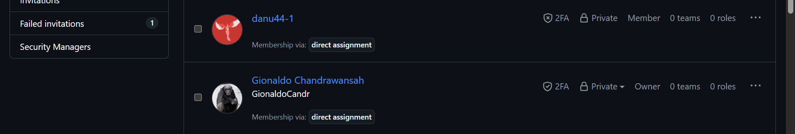

# Tugas Pendahuluan Modul 7: Debugging dan Telaah Kode
**Mata Kuliah:** Praktikum Pengembangan Aplikasi Web (052356) · 1 SKS · Semester 5  
**Dosen Pengampu:** Muhammad Fakhrul Safitra, S.Kom., M.Kom.  
**Program Studi:** Ilmu Komputer, Universitas Pertamina  
**Nama Mahasiswa:** Gionaldo Chandrawansah  
**NIM:** 105224031  
**Produk:** Stealth Password Vault (`web-password-stealth-vault`)  
**Tautan Repositori:** [https://github.com/GionaldoCandr/web-password-stealth-vault](https://github.com/GionaldoCandr/web-password-stealth-vault)  

---

## 1. Langkah Reproduksi Galat pada Produk

Laporan langkah reproduksi disusun mengikuti standar baku penelusuran galat (*bug reporting*), diambil dari pengalaman nyata pengembangan fitur pengelolaan data kredensial dan audit log pada produk **Stealth Password Vault**:

- **Judul Galat:** Pelanggaran Integritas Foreign Key Prisma `P2003` saat Menghapus Entitas Induk `VaultCredential` yang Memiliki Riwayat Relasi `AuditLog`
- **Lingkungan (Environment):**
  - Sistem Operasi: Windows 11 Pro 64-bit
  - Runtime: Node.js v24.x LTS
  - Framework: Next.js 16.4.2 (App Router, Server Actions)
  - ORM & Driver: Prisma ORM 7.10.1 (`@prisma/adapter-pg`)
  - Basis Data: PostgreSQL 18
  - Cabang & Commit: `main` (`commit 7caa79d`)
- **Data Awal (Initial State):**
  - Tabel `VaultCredential` memiliki baris kredensial dengan `id: 1` (`service: "portal.universitaspertamina.ac.id"`).
  - Tabel `AuditLog` memiliki 1 baris catatan audit yang merujuk ke akun tersebut (`credentialId: 1`, `deviceId: "PC-STEALTH-MASTER-01"`).
  - Skema basis data mendefinisikan batasan foreign key referensial `ON DELETE RESTRICT` pada kolom `credentialId`.
- **Langkah Reproduksi Bernomor:**
  1. Jalankan server pengembangan lokal dengan perintah `npm run dev`.
  2. Buka peramban (Google Chrome) dan arahkan ke rute detail kredensial: `http://localhost:3000/vault/1`.
  3. Buka panel Chrome DevTools (`F12`), pilih tab **Network**, dan centang opsi **Preserve log**.
  4. Klik tombol aksi **"Hapus Kredensial"** yang memicu Server Action `hapusCredential(1)`.
  5. Amati keluaran pada terminal server Next.js dan respons lalu lintas pada tab Network.
- **Hasil yang Diharapkan:**
  - Kredensial berhasil dihapus secara bersih beserta seluruh jejak audit terkait melalui transaksi atomik dua kueri (`prisma.$transaction`), kemudian peramban secara otomatis dialihkan (*redirect*) kembali ke rute indeks `/vault`.
- **Hasil Aktual:**
  - Server Action terhenti (*crash*) dan melempar eksepsi `PrismaClientKnownRequestError` dengan kode galat `P2003`:  
    ```text
    Foreign key constraint violated on the fields: (`credentialId`)
      code: 'P2003',
      meta: { modelName: 'VaultCredential', field_name: 'credentialId' }
    ```
  - Peramban menerima galat server 500 karena operasi penghapusan langsung `prisma.vaultCredential.delete({ where: { id: 1 } })` ditolak oleh PostgreSQL akibat masih adanya baris anak di tabel `AuditLog`.
- **Frekuensi Terjadi:**
  - **100% (Selalu terjadi)** setiap kali menghapus akun kredensial yang memiliki minimal satu catatan jejak audit tanpa menjalankan transaksi pembersihan berantai.

---

## 2. Perbedaan Breakpoint, Conditional Breakpoint, dan Logpoint di VS Code

| Jenis Titik Henti | Cara Kerja & Karakteristik | Situasi Penggunaan yang Tepat |
| :--- | :--- | :--- |
| **Breakpoint (Biasa)** | Menjeda (*pause*) eksekusi kode program secara mutlak dan menyeluruh setiap kali alur eksekusi mencapai baris tersebut. Saat berhenti, developer dapat menginspeksi seluruh variabel lokal di panel *Variables*, memantau *Call Stack*, serta melangkah baris per baris (*Step Over* `F10`, *Step Into* `F11`). | Menguji pemanggilan awal fungsi Server Action (misal `tambahCredential`), guna memastikan objek `formData` atau parameter masukan dari formulir peramban berhasil diterima server dengan struktur dan tipe data yang benar. |
| **Conditional Breakpoint** | Hanya menjeda eksekusi program **apabila ekspresi logika/kondisi boolean tertentu bernilai `true`** (*truthy*), atau jika jumlah hitungan eksekusi (*hit count*) tertentu telah tercapai. Bila kondisi `false`, eksekusi program tetap berjalan normal tanpa terhenti. | Menelusuri perulangan (*looping*) impor massal atau pemrosesan batch 100 entri kredensial, di mana galat dekripsi hanya terjadi pada layanan tertentu (contoh kondisi: `item.service === "github.com"` atau `index === 45`). Hal ini menghindari keharusan menekan tombol *Continue* (`F5`) berulang kali secara manual. |
| **Logpoint** | **Sama sekali tidak menghentikan jalannya eksekusi program**, melainkan mengevaluasi ekspresi dan mencetak pesan terformat (*string interpolation*) langsung ke panel **Debug Console** VS Code (contoh sintaks: `Proses audit device={deviceId}, status={action}, waktu={Date.now()}`). | Memantau latensi enkripsi AES-GCM atau pertukaran data real-time pada Client Component yang sensitif terhadap jeda waktu (*timing-sensitive*, misal websocket p2p handshake) tanpa merusak flow jaringan, serta tanpa perlu mengotori berkas sumber dengan `console.log` sementara yang berisiko lupa dihapus saat commit ke Git. |

---

## 3. Arti Kode Galat Prisma P2002, P2003, dan P2025 serta Contoh Kejadian

### A. Kode Galat `P2002` — *Unique Constraint Violation*
- **Arti:** Kueri mutasi (`create` atau `update`) ditolak oleh basis data karena melanggar batasan nilai unik (*unique constraint*) yang ditentukan oleh anotasi `@unique` atau komposit `@@unique`.
- **Contoh pada Entitas Produk:**
  - *Entitas Induk `VaultCredential` (padanan Item):* Pengguna mencoba mendaftarkan kredensial baru dengan nama layanan `service: "portal.universitaspertamina.ac.id"`, padahal domain layanan tersebut sudah pernah terdaftar di dalam brankas (kolom `service` memiliki constraint `@unique`).
  - *Entitas Anak `AuditLog` (padanan Ulasan):* Klien mengirimkan entri audit baru untuk kredensial yang sama dari perangkat yang sama (`credentialId: 1`, `deviceId: "PC-STEALTH-MASTER-01"`), sehingga melanggar constraint unik komposit `@@unique([credentialId, deviceId])`.

### B. Kode Galat `P2003` — *Foreign Key Constraint Violation*
- **Arti:** Pelanggaran integritas referensial antar-tabel (*foreign key integrity failure*). Terjadi ketika sebuah record mencoba merujuk ke record induk yang tidak ada, atau saat menghapus record induk yang masih dirujuk oleh record anak pada skema `onDelete: Restrict` / `NoAction`.
- **Contoh pada Entitas Produk:**
  - Menghapus baris `VaultCredential` (Item) yang masih memiliki relasi aktif di tabel `AuditLog` (Ulasan) saat skema foreign key memakai aturan `onDelete: Restrict`.
  - Mencoba menyisipkan baris `AuditLog` baru dengan nilai `credentialId: 999999` di mana ID kredensial `999999` tersebut tidak terdaftar di tabel `VaultCredential`.

### C. Kode Galat `P2025` — *Record to Update or Delete Not Found*
- **Arti:** Operasi mutasi baris spesifik (`update`, `delete`, atau operasi relasi bersyarat) gagal dieksekusi karena record target yang dicari berdasarkan klausa `where` tidak ditemukan di dalam basis data.
- **Contoh pada Entitas Produk:**
  - Seorang pengguna membuka formulir pengubahan catatan (*recovery notes*) kredensial ID 5 di tab peramban, namun di saat bersamaan kredensial tersebut telah dihapus di tab peramban lain. Ketika tombol "Simpan Perubahan" diklik, perintah `prisma.vaultCredential.update({ where: { id: 5 }, ... })` gagal menemukan baris tersebut dan melempar galat `P2025`.

---

## 4. Evaluasi Ekspresi JavaScript dan Next.js Server Action

### A. Mengapa `Boolean("false")` Bernilai `true`?
Dalam spesifikasi resmi ECMAScript (JavaScript), konversi tipe data string ke boolean (*type coercion*) mengikuti aturan evaluasi nilai *Truthy* dan *Falsy*:
1. Di dalam bahasa JavaScript, nilai string yang dianggap **Falsy** hanyalah **string kosong tanpa karakter sama sekali: `""`** (panjang string = 0).
2. String apa pun yang memiliki panjang karakter $\ge 1$—termasuk string berisi teks `"false"`, string spasi `" "`, string angka `"0"`, maupun string `"null"`—didefinisikan secara mutlak sebagai nilai **Truthy**.
3. Oleh karena itu, pemanggilan konstruktor `Boolean("false")` mengevaluasi string non-kosong berpanjang 5 karakter tersebut dan menghasilkan nilai boolean primitif **`true`**.

> **Implikasi & Solusi pada Pengembangan Aplikasi:**  
> Masukan formulir HTML selalu dikirim dalam bentuk string (misal atribut `isActive="false"` dari `<select>` atau checkbox). Jika developer menulis `Boolean(formData.get("isActive"))`, nilainya akan keliru menjadi `true`. Cara penanganan yang tepat adalah membandingkan nilai string secara eksplisit (`val === "true"`), atau memanfaatkan skema validasi Zod dengan `z.stringbool()` / `z.preprocess()`.

---

### B. Mengapa `redirect()` Tidak Boleh Dipanggil di Dalam Blok `try`?
Pada arsitektur Next.js (App Router), fungsi `redirect()` bekerja dengan mekanisme khusus:
1. **Mekanisme Kerja `redirect()`:**  
   Fungsi `redirect()` tidak mengembalikan objek respons HTTP standar, melainkan **secara sengaja melempar galat khusus (*special internal exception*) bernama `NEXT_REDIRECT`**.
2. **Tujuan Pelemparan Eksepsi:**  
   Eksepsi `NEXT_REDIRECT` sengaja dilempar untuk menghentikan seketika (*short-circuit*) seluruh alur komputasi fungsi Server Action atau Server Component yang sedang berjalan, agar kontrol eksekusi langsung kembali ke kerangka kerja Next.js lapisan terluar untuk merespons peramban dengan status HTTP `307` (Temporary Redirect) atau `308` (Permanent Redirect).
3. **Penyebab Masalah Bila di Dalam Blok `try`:**  
   Jika pemanggilan `redirect()` diletakkan di dalam blok `try { ... } catch (error) { ... }`, maka eksepsi `NEXT_REDIRECT` tersebut akan **secara keliru tertangkap (*swallowed / intercepted*) oleh blok `catch` developer sendiri**. Akibatnya:
   - Blok `catch` mengira terjadi galat sistem yang tidak diinginkan (misal galat koneksi basis data).
   - Eksepsi tidak sampai ke kernel Next.js, sehingga respons pengalihan HTTP gagal diteruskan ke peramban pengguna.
   - Antarmuka web pengguna tetap berada di halaman semula dan sering kali menampilkan pesan galat palsu (*false positive error*).

> **Praktik yang Benar:**  
> Letakkan pemanggilan `redirect("/vault")` tepat **di luar blok `try-catch`** (setelah seluruh transaksi basis data selesai dieksekusi secara valid). Jika terpaksa harus diletakkan di dalam blok `try`, periksa jenis galat di blok `catch` menggunakan pembantu Next.js:  
> ```typescript
> import { isRedirectError } from "next/dist/client/components/redirect-error";
> // ...
> catch (error) {
>   if (isRedirectError(error)) throw error; // Teruskan kembali ke Next.js
>   // Tangani galat lainnya...
> }
> ```

---

## 5. Pasangan Telaah Kode (*Code Review Peer*)

- **Nama Mahasiswa Pemilik Repositori:** Gionaldo Chandrawansah  
- **NIM:** 105224031  
- **URL Repositori Produk:** [https://github.com/GionaldoCandr/web-password-stealth-vault](https://github.com/GionaldoCandr/web-password-stealth-vault)  
- **Nama Pasangan Telaah:** Danu Dimas Putra
- **NIM Pasangan Telaah:** `105224003`  
- **URL Repositori Pasangan:** https://github.com/danu44-1/Praktikum_Pem_WEB
- **Bukti Undangan Collaborator:**  
  Undangan kolaborator telah dikirimkan melalui menu **Settings $\rightarrow$ Collaborators** pada repositori GitHub dan status undangan telah diterima (*Access Accepted - Write/Admin access*).

> **Tangkapan Layar Bukti Collaborator GitHub:**


---

## 6. Catatan Pemanfaatan Kecerdasan Artifisial (AI)

| Atribut | Keterangan |
| :--- | :--- |
| **Alat Bantu AI** | Antigravity AI (Google Deepmind Engine) |
| **Tujuan & Perintah Utama** | 1. Memformulasikan langkah reproduksi galat terstruktur sesuai standar ilmiah perutean dan penanganan relasi basis data pada produk Stealth Password Vault.<br>2. Menganalisis perbedaan teknis operasional fitur debugging VS Code (Breakpoint, Conditional Breakpoint, Logpoint).<br>3. Menganalisis spesifikasi ECMAScript type coercion `Boolean("false")` dan mekanisme internal exception `NEXT_REDIRECT` Next.js.<br>4. Memetakan kode galat Prisma (P2002, P2003, P2025) ke entitas produk `VaultCredential` dan `AuditLog`. |
| **Bagian yang Dibantu** | Penyusunan format laporan reproduksi galat, penjelasan konseptual perbedaan alat debugging VS Code, serta penjelasan rinci perilaku eksepsi Next.js. |
| **Metode Verifikasi Mandiri** | 1. Menguji ekspresi `Boolean("false")` langsung di konsol Node.js dan Chrome DevTools untuk membuktikan nilai kembaliannya adalah `true`.<br>2. Memeriksa dokumentasi resmi Next.js mengenai penanganan `redirect()` dan eksepsi `NEXT_REDIRECT`.<br>3. Memeriksa dokumentasi referensi kode galat Prisma ORM (*Error code reference* P2002, P2003, P2025). |

